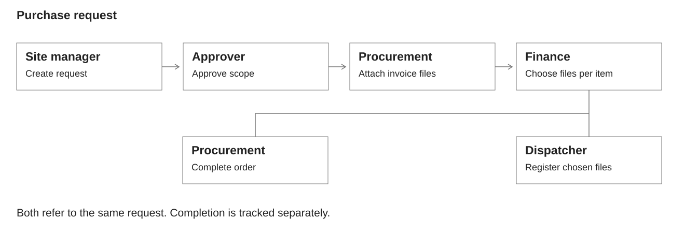
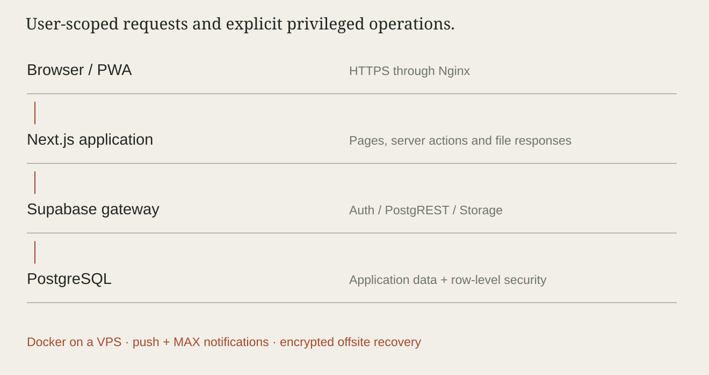

# MAYAK

I built MAYAK for a construction company and still maintain it. It's where the team keeps project tasks, site photos, timesheets, material records and purchase requests. I handled the interface, application, database rules and deployment, then moved it from the original server to a VPS.

The stack is Next.js, React, TypeScript and self-hosted Supabase, running in Docker behind Nginx.

[PDF](downloads/MAYAK-Case-Study.pdf) · [Walkthrough, 2:42](assets/walkthrough/MAYAK-Walkthrough.mp4) · [Transcript](assets/walkthrough/transcript.md)

## What I was trying to solve

A request starts on a construction site, but several people in the office may need to do something with it. The site manager knows what's needed. Procurement finds supplier options. Finance decides which invoices to use. Someone else puts those invoices in the payment register.

The useful thing to preserve through all of that is fairly simple: what was requested, what changed, who made the decision, and whose turn it is now.

That became the basis of the procurement workflow. The rest of MAYAK uses the construction project as its common context: tasks, reports, hours, stock movements, documents and contracts belong to a project people have access to. Those modules share context, but they don't automatically update one another. Approving an invoice, for example, doesn't record a material receipt.

## A request from start to finish

Take a request for plywood and concrete accessories. The site manager adds them as separate items, sets a required date and priority, and sends the request to an approver. Once approved, it goes to procurement.

Procurement adds supplier invoices under the relevant item. A group can have a title, a comment and several files. Finance then chooses individual files within those groups. Each requested item needs at least one selected invoice; the alternatives stay in the history.

The part that needed care was what happened after finance. Procurement still had an order to finish, while the dispatcher had invoices to register. Giving the whole request one more “done” flag would hide one person's unfinished work when the other finished.

I kept one request and gave registration its own linked entry and per-file marks. Procurement can close its work independently. The register stays visible, including entries already registered.

There are exceptions to the normal route. Procurement can finish a request without finance when that's the actual outcome. A direct invoice goes straight to finance and dispatch. Returns and recalls have their own permission checks and permitted destinations.

[Workflow details and data model](docs/workflow.md)

## The implementation choices

**Finance approval is a database operation.** It updates file decisions, the request status, the register and the event history together. The SQL routine locks the request, checks the actor and company, rejects files from another request, and requires a selection for every material item. A failed check leaves the approval uncommitted.

**Other handoffs check the current state again.** Someone can leave a page open while a colleague moves the request forward. The update includes the expected status, so that old page can't overwrite the new stage. The event write for these ordinary actions is separate; their guarantee is different from the finance transaction.

**Rank and duties answer different questions.** A procurement employee shouldn't gain management permissions just to handle invoices. I kept managerial rank separate from the supply, finance and dispatcher duties. Those duties can be combined on one profile.

**Task completion has a review step.** An assignee submits work, then the task author accepts it or returns it. The normal status selector can't skip acceptance. There's a fallback for management if the original author has been deleted.

## How it's put together

Next.js server actions use the user's session to call Supabase through its HTTP gateway. Auth manages sessions, PostgREST handles data requests, and Storage holds uploaded files. PostgreSQL row-level security constrains ordinary queries by company and project access.

Some operations need elevated access. I keep those server paths separate and check their actor and scope explicitly. The platform activity export, for instance, checks the platform administrator in the export path itself, rather than relying on the page around it being protected.

Invoice downloads start with an authenticated file lookup. The server fetches the file through a short-lived storage URL and streams it with the original filename and private/no-store headers. This also gave me one place to fix the browser behaviour and the confusing download names users had reported.

[Architecture](docs/architecture.md) · [Access rules](docs/access.md)

## Small details that mattered in use

On phones, photos are resized before upload. Small JPEGs are left alone, and a failed conversion falls back to the original. The PWA has an offline fallback page; offline editing and synchronization aren't implemented.

MAX pairing uses a random one-time code, stored as a hash. Messages bring the next responsible person back to the request. Sending is best-effort, so the application's work queue remains important even when a notification fails.

One regression was especially mundane: approved direct invoices stayed in the ordinary working list, waiting for a procurement step they didn't have. I fixed the list rule and added tests for both direct invoices and normal requests. These small distinctions tend to be where the real operating rules show up.

## Deployment and recovery

I also moved the running system to a VPS. The migration included database roles and grants, uploaded files, file attributes, environment configuration and HTTPS. Restoring the database alone wasn't enough: the records could load while photographs and invoice downloads still failed.

The current backup job keeps encrypted, versioned snapshots locally and offsite. I tested a cloud restore into a separate directory and database, including the file attributes and proxy configuration. The password and recovery configuration have a separate off-server copy.

[Migration and recovery notes](docs/operations.md)

## Where it stands

For this case study, I reran 12 focused tests for MAX connection codes, direct-invoice list behaviour and activity-report filtering/export. All passed. There are also SQL regression scripts and a backup integration test, but this isn't a complete browser end-to-end suite.

There are still things I'd improve. The service runs on one VPS. Notifications have no durable outbox. Material balances are calculated from movement history, without published large-scale performance measurements. Live files and the database aren't captured as one atomic snapshot.

I haven't measured an attributable ROI or a percentage reduction in administrative time. What I can show is the deployed application, the rules it implements, the fixes made from user feedback, and a recovery procedure I've actually exercised.

[Verification and limits](docs/verification.md)

---

The walkthrough is an English reconstruction with invented sample data, not a production screen recording. This repository contains the case study and media; application source, staff records, invoices and server credentials are excluded.

[English captions: SRT](assets/walkthrough/captions.srt) · [WebVTT](assets/walkthrough/captions.vtt) · [Ilya on GitHub](https://github.com/EshkirenokCode)

Updated October 2026.
