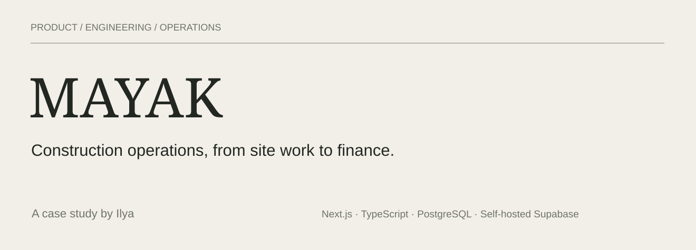

# MAYAK

A construction operations platform I designed, built and deployed for a construction company.

**My role:** product design, full-stack development and operations.  
**Stack:** Next.js 16, React 19, TypeScript, PostgreSQL, self-hosted Supabase, Docker and Nginx.  
**Delivery:** a running product, ongoing changes, a server migration and tested offsite recovery.

[Read the PDF](downloads/MAYAK-Case-Study.pdf) · [Watch the walkthrough — 2:42](assets/walkthrough/MAYAK-Walkthrough.mp4) · [Read the transcript](assets/walkthrough/transcript.md)

## The problem

A construction project produces several kinds of information at once: work assignments, site photographs, attendance, material movements, invoices and contracts. The difficulty is keeping the project, the responsible person and the next action clear as work passes between the site and the office.

I built MAYAK to put those records in one system. A site manager needs to report from a phone. Procurement needs to compare supplier documents. Finance needs to choose what can move forward. Management needs to see unresolved work without asking each person for an update.

The implementation had to fit an operating company. I made changes incrementally, kept the product self-hosted, and took responsibility for deployment and recovery as well as the interface.

## What I built

| Area | What the product handles |
|---|---|
| Projects | Project records, assigned teams, status, gallery and a project-level overview. |
| Tasks | Multiple assignees, subtasks, checklists, comments, issues, start dates, deadlines, a Gantt view and acceptance. |
| Site records | Photo reports, direct gallery uploads, worker and staff timesheets, and optional location evidence. |
| Materials | Orders, receipts, write-offs and transfers, with balances calculated from movement history. |
| Procurement | Multi-item requests, supplier invoice groups, file-level finance decisions, corrections and registration. |
| Commercial records | Documents, folders, contracts, acts and payment records. |
| Administration | Company activation, team management, module controls and a restricted activity report with export. |
| Notifications | Browser push and MAX messages for people whose action is required. |

These modules share project context and access rules. They are not all one automatic transaction: approving an invoice does not, for example, record a material receipt.

## One complete workflow

A site manager requests plywood and concrete accessories. I use this example because it crosses several people, a collection of files, database rules and two different definitions of completion.

1. **Create and approve.** The request contains separate material items, a required date, priority and an approver. Approval puts it in procurement's queue.
2. **Collect alternatives.** Procurement attaches invoice files to each item. Groups retain their title and comment; each item needs an invoice before the request goes to finance.
3. **Choose actual files.** Finance selects files within the groups. A selection must cover every material item. Unselected alternatives remain in history.
4. **Commit the decision.** A database routine checks the finance duty, active company, request stage and file ownership. It locks the request row and writes the decisions, next status, registry entry and event in one transaction.
5. **Finish the two responsibilities.** Procurement completes its order work. Independently, the dispatcher marks selected invoices as registered. The registry record stays visible after registration, with a completed state.

The request is not duplicated for the dispatcher. Its linked registry entry and per-file registration marks describe a separate responsibility. Closing procurement work must not make an unfinished registration disappear.

There are also shorter and corrective routes: direct invoices go to finance and dispatch, procurement can finish a request without a finance stage, and permitted actors can return or recall a handoff. I modelled these explicitly instead of forcing every case through the normal route.

[Detailed workflow and data model](docs/workflow.md)

## Decisions that shaped the implementation

### Responsibility is not a higher rank

I separated managerial rank from operational duties. A person can handle procurement, finance or dispatch without gaining the authority of a site manager. Duties can be combined. Company and project visibility still constrain which records the person can access.

### “Submitted” is not “accepted”

A task assignee submits work for review. The task author accepts it or returns it for revision. The normal status selector cannot bypass these transitions. If the author is deleted, management can resolve a review that would otherwise be stranded.

### Put the finance decision in the database

The finance approval changes several related records. Keeping that operation in one SQL routine prevents a request from appearing approved while its registry entry or selected-file flags are missing. The routine validates its own actor and company even though it runs with elevated database privileges.

### Handle stale pages deliberately

Ordinary request transitions recheck the current stage and qualify the update with that stage. If another person has already moved the request, the action returns an error rather than overwriting the new state. These ordinary actions and the atomic finance routine are different mechanisms; I do not describe every event write as transactional.

### Keep delivery outside the business decision

Push and MAX are best-effort notifications. A failed message does not become the source of truth for whether finance approved a request. The request state and the person's working queue remain in MAYAK. There is currently no durable notification outbox.

## Architecture and access

The browser reaches Next.js through Nginx over HTTPS. Server actions use the user's session to call the self-hosted Supabase gateway. Auth manages sessions, PostgREST exposes PostgreSQL, and Storage handles uploaded files.

On ordinary user-scoped paths, PostgreSQL row-level security enforces company and project visibility. The interface hides unavailable actions and server checks provide useful errors, but neither replaces the database boundary. A small set of administrative and workflow operations uses privileged access; those paths have explicit checks and are separate from normal user queries.

Invoice downloads also start with an authenticated, permitted file lookup. The server uses a short-lived storage URL to fetch the file, then streams it with its original filename and private, non-cacheable response headers. It does not publish a permanent public URL for the invoice.

[Architecture](docs/architecture.md) · [Access model](docs/access.md)

## Field conditions and operations

I treated phone use as part of the implementation. Images are resized before upload to reduce bandwidth. Small JPEGs are kept as they are; a failed conversion falls back to the original file. The PWA provides an offline fallback page, not offline editing or queued synchronization.

I also moved the application from its original server to a VPS. That work included database roles and permissions, file storage, extended file attributes, environment configuration, HTTPS and the final data handoff. Files were part of the migration, not an afterthought to restoring the database.

Backups now include an encrypted, versioned offsite copy. I tested recovery into a separate directory and test database, including file attributes and proxy configuration. The password and recovery configuration are stored separately from the encrypted repository.

[Deployment, migration and recovery](docs/operations.md)

## Validation and limits

I have focused tests for MAX connection codes, the direct-invoice working-list regression and activity-report filtering/export. The latest check for this case study ran **12 focused tests, all passing**. There are also database regression scripts and a versioned-backup integration test. I do not present this as full end-to-end coverage.

The product runs on one VPS. That is a practical deployment for its current use, not a high-availability design. Notification delivery is not guaranteed. Live database and file backups are not a single cross-system snapshot. Material balances are calculated from history; I have not published large-scale performance measurements.

[Verification and known limits](docs/verification.md)

## Result and my contribution

MAYAK is a deployed system used for construction operations. The delivered scope includes the application, project-based access, procurement workflow, messaging integration, exports, deployment, migration and recovery procedures.

My work covered requirements, interface design, React and TypeScript implementation, SQL routines and policies, integrations, deployment and production fixes. User feedback led to changes such as per-file invoice selection, a separate registry lifecycle, clearer mobile controls and original filenames on downloads.

I have not measured a defensible percentage reduction in administrative time or an ROI figure. The evidence in this case is the implemented workflow, the technical decisions, the test scope and a verified recovery procedure.

## Materials

- [PDF case study](downloads/MAYAK-Case-Study.pdf)
- [English walkthrough](assets/walkthrough/MAYAK-Walkthrough.mp4), with quiet music and embedded captions
- [Transcript](assets/walkthrough/transcript.md), [SRT](assets/walkthrough/captions.srt) and [WebVTT](assets/walkthrough/captions.vtt)
- [Workflow](docs/workflow.md), [architecture](docs/architecture.md), [access](docs/access.md), [operations](docs/operations.md) and [verification](docs/verification.md)

The walkthrough uses invented sample data and an English visual reconstruction. It is not a recording of the production interface. Application source code, staff records, invoices and infrastructure credentials are not included in this repository.

Written and maintained by [Ilya](https://github.com/EshkirenokCode). Current implementation reviewed in October 2026.
