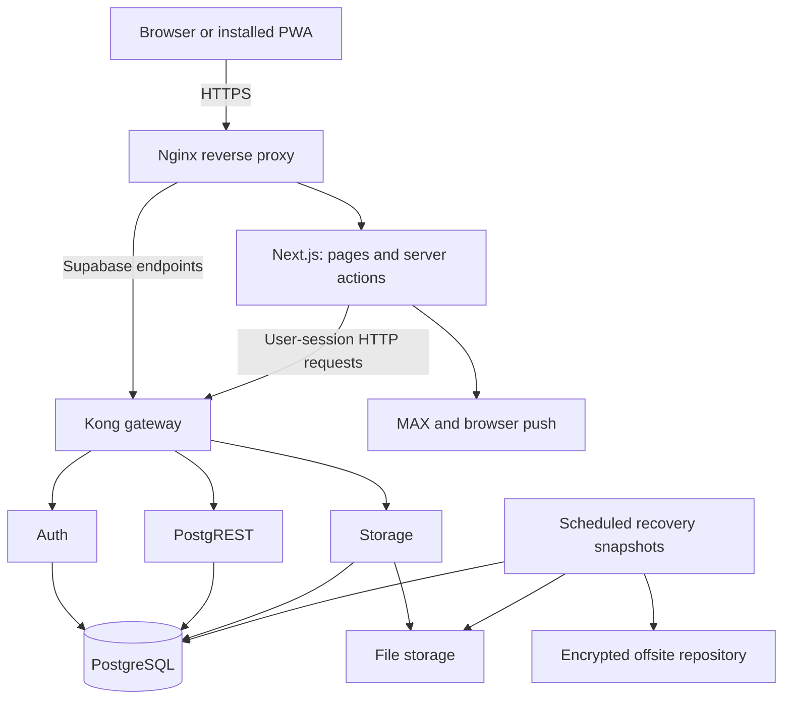

# Architecture and request paths

[Back to the case study](../README.md)

## Runtime

The application and self-hosted services run in Docker on a VPS. The reverse proxy terminates HTTPS. The system is deliberately not split into a fleet of independently deployed application services.

Next.js server actions handle the product's forms and workflow operations. The application uses Supabase's HTTP interfaces rather than a separate direct PostgreSQL connection for ordinary user operations. PostgreSQL functions handle operations that need a database-level atomic boundary.

## Why this shape

Self-hosted Supabase provides sessions, a data API, file storage and PostgreSQL without requiring me to implement each service from scratch. Next.js keeps page rendering and form actions in the same application. Shared TypeScript types help keep interface and domain logic aligned.

The cost is operational responsibility. I have to manage service configuration, storage, credentials, migrations, backups and recovery. A single VPS is simpler to operate, but it is also a failure domain; this architecture does not provide automatic failover.

## A normal mutation

1. A form calls a server action.
2. The action loads the authenticated viewer, company, rank and duties.
3. It validates input and checks the operation's prerequisites.
4. A user-session Supabase client sends an HTTP request through the gateway.
5. The database evaluates the relevant policies or the called routine's explicit checks.
6. The application refreshes affected views and, where appropriate, notifies the next participant.

Most ordinary queries remain scoped to the user. Administrative operations are exceptions, not an alternative general-purpose data layer. They require explicit authorization before a service-role client is used.

## Invoice download

The file handler is an authenticated application route. It checks the current session, reads the permitted file metadata using the session-bound client, creates a 60-second storage URL, fetches the file and streams the response.

The response retains the original filename, sets private/no-store caching and prevents MIME sniffing. Inline viewing is limited to PDF and supported raster-image types. Other file types are downloaded. The short-lived upstream URL is not a permanent public attachment URL.

## Mobile behaviour

The PWA is a browser application with an installable shell, responsive navigation and browser push. It does not have a separate native application backend.

Before upload, the client can resize a decodable image to a maximum side of 1600 pixels and encode it as JPEG at quality 0.82. Already-small JPEGs avoid another conversion. A conversion failure returns the original file so the application can report the actual upload outcome.

The service worker has an offline fallback page. It does not cache a private working database or implement offline edits and later synchronization.

## Interface boundaries

Forms primarily use server actions. HTTP routes handle file responses, exports, scheduled deadline processing and the MAX webhook. An export must authorize the operation itself; protecting only the surrounding admin page would not protect a separately requested download.

I have not published a speculative REST API for the whole application. The case study describes the actual interface boundaries rather than implying an external integration contract that the product does not offer.
