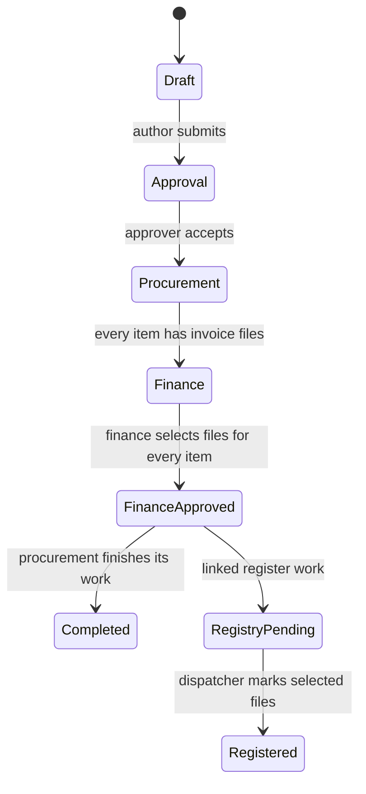
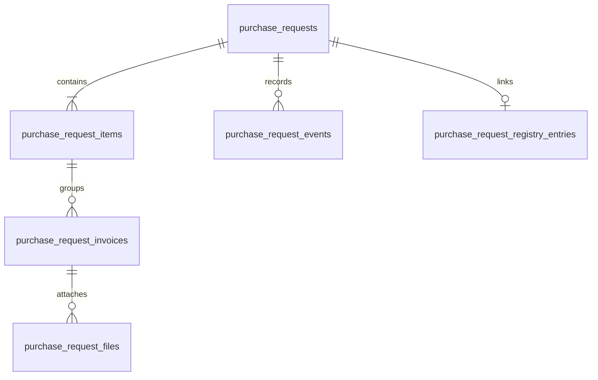

# Purchase requests: state, files and completion

[Back to the case study](../README.md)

## The normal route

The two lines after finance approval represent different workstreams, not two duplicate requests. Request completion and registry completion are stored separately. The register keeps registered entries visible.

This diagram shows the successful route. Returns, recalls, cancellation and rejection are additional transitions with their own checks. “In work” is an optional marker within a department's current stage, not another mandatory stage in this diagram.

## The data model

A request holds its project, author, approver, priority, required date, kind and current status. An item represents one material requirement. An invoice group has a title and comment. Files within that group retain their original filenames and their own finance decisions and registration marks.

That distinction is important. “Supplier A” may be a useful group title, but it should not replace the filename of a PDF. Finance may select only some files in the group, so a group-level flag is not enough to represent the decision.

Unselected invoice files stay in history. They are visually less prominent after the decision; they are not deleted to make the current view look tidy.

## A finance approval, step by step

The application calls `approve_purchase_request_files(req, selected_ids)`. The routine:

1. Requires an authenticated actor with the finance duty.
2. Locks the request row and verifies its company, active-company status and finance-review stage.
3. Rejects an empty selection or a selected file that does not belong to this request and an invoice group.
4. Checks that every request item has at least one selected invoice file.
5. Saves per-file decisions and updates the group summary flags.
6. Changes the request to `finance_approved`.
7. Creates or resets the linked registry entry to pending.
8. Appends a request event identifying the actor and transition.

These changes happen in the database routine's transaction. The application can then notify procurement and dispatch. Notification delivery is separate from committing the business decision.

## Stale views and ordinary transitions

An ordinary handoff first reads the request, checks the expected stage, and updates it using both its ID and current status. If the stage has changed since the screen was loaded, the action does not overwrite the new state.

This conditional update prevents a stale action from moving a request from the wrong stage. It is not the same guarantee as the finance routine: ordinary transitions write their event separately. I keep that distinction explicit.

## Corrective and shorter routes

- **Return for revision:** choose an allowed earlier level. The recipient sees the request in the appropriate working queue.
- **Recall:** the person who made a handoff can withdraw it where the route permits. Related decision state is reset by the database routine rather than by isolated interface changes.
- **Procurement completion without finance:** procurement can close a request when that is the actual outcome.
- **Direct invoice:** author → finance → dispatcher. After finance approval it leaves ordinary working-request tabs; it does not wait for a supply completion step that its route never created.

The direct-invoice list behaviour has a focused regression test because an earlier version left approved direct invoices in the ordinary work queue.

## What counts as finished?

There is no single “done” button for every participant. Procurement is finished when its request work is completed. Dispatch is finished when the selected files are registered. Retaining both states prevents one department's completion from hiding another department's outstanding work.
